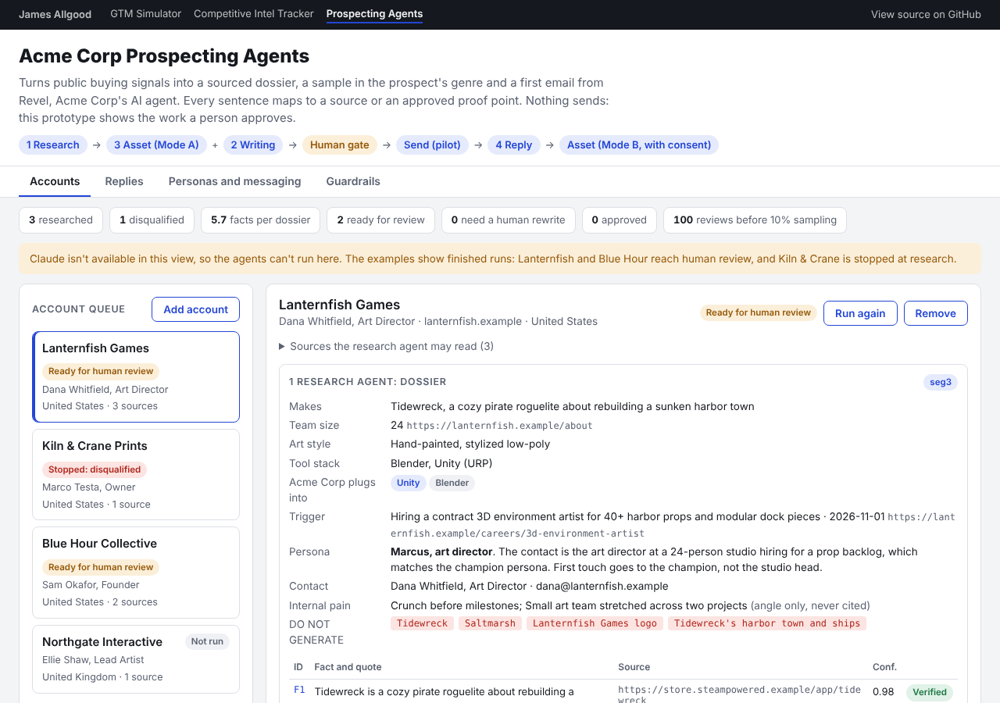

# Acme Corp Prospecting Agents

Four Claude agents that turn public buying signals into a researched, consent-based first email for small
studios and creative businesses. A research agent builds a sourced dossier, an asset agent writes a sample
prompt in the prospect's genre, a writing agent drafts the email, and a reply agent sorts what comes back.
A person reviews the first 100 emails before they send. Once the agents have earned that trust, review drops
to a 10% random sample so the program can scale.

**[Open the live demo](https://jamesallgood99.github.io/acme-prospecting-agents/)** · Built by
[James Allgood](https://www.linkedin.com/in/jamesallgood) · Companion to my
[GTM Simulator](https://github.com/jamesallgood99/gtm-simulator) and
[Competitive Intel Tracker](https://github.com/jamesallgood99/competitive-intel-tracker)

## Why this exists

Every outbound email has to prove someone looked at the account. Done by hand, that means reading the
prospect's store or game page, job posts and about page, picking who to write to, ruling out customers and
competitors, finding an asset in their genre, writing the email and checking every claim. That's 20 to 30
minutes per prospect, much of it spent chasing broken links and out-of-date data, or 300 to 500 hours for a
1,000-account test. Those are hours SDRs could spend on the conversations that move deals forward.

I ran hyper-personalized agentic email at CompScience on HubSpot, ZoomInfo and Sendoso. This repo rebuilds
the idea in the open for a fictional company, Acme Corp, an AI 3D-model generator selling to small game
studios, print shops and product-visual teams. Every account in the demo is fictional and uses `.example`
domains.

## How it works

| Agent | What it does | What code checks |
|---|---|---|
| **1 Research** | Turns an account's public pages into a sourced dossier: segment, team size, tool stack, a trigger under 60 days old, the persona to write to, and a do-not-generate list of their IP. | Drops any fact it can't find on its source page. Stops on existing customers, competitor domains, studios over 200, non-US contacts and anyone who could be a minor. |
| **3 Asset (Mode A)** | Writes a Text to 3D prompt for the asset their trigger names, in their style, and links to Acme Corp with it preloaded. | Never names or describes their characters, titles or logos. |
| **2 Writing** | Drafts touch one from Revel, Acme Corp's AI agent, with the prospect as the main character: their work, their pain, one approved proof point, the plugin for their engine, and the prompt link. | Banned claims, a 0 to 10 spam score (fails at 5), length, one link, a source for every claim, shown in a claim map beside the email. A failed draft gets one rewrite, then goes to a person. |
| **Human gate** | A person reviews the first 100 emails, then a 10% random sample. | Sending pauses if QA falls below 95%, spam complaints pass 0.1%, or any IP rule breaks. |
| **4 Reply** | Sorts replies into nine categories, takes the safe action, and hands money, legal terms and live buyers to a person. | Below 0.8 confidence, a person decides. |
| **Asset (Mode B)** | Generates from a prospect's own sketch or photo. | Only runs when the reply clearly grants permission. |

Each agent is its own prompt with a strict JSON output schema, chained in order. Code, not the model, decides
what passes.

## The IP line

The agent never generates a copy of a prospect's own characters or products without permission. An
unsolicited AI copy of an artist's work confirms exactly what studios fear about AI. Instead, the call to
action invites them to send a sketch or a product photo. They still get to see their own idea in 3D, the
company gets consent, and every submission is a strong buying signal.

## Running it

The demo is a single self-contained `index.html`. On GitHub Pages it shows a finished run on the Lanternfish
Games example, along with the personas, messaging library and guardrails. A five-step tour opens on your first
visit; add `?tour` to the URL to open it again. The agents call Claude through the
claude.ai artifact runtime (`window.claude`), so live runs on new accounts work when the page is opened as a
Claude artifact. Nothing sends email.

## Pilot design

- 1,000 accounts over four weeks, agentic against a templated control, three touches over about ten days.
- Keep it if the agentic version doubles the template's positive reply rate and drives sketch submissions
  and enrollments under the target cost per paid account.
- Sending runs on warmed secondary domains with per-inbox caps, a CAN-SPAM opt-out in every email, and one
  shared suppression list for customers, unsubscribes, anti-AI replies and competitors.

## License

MIT
